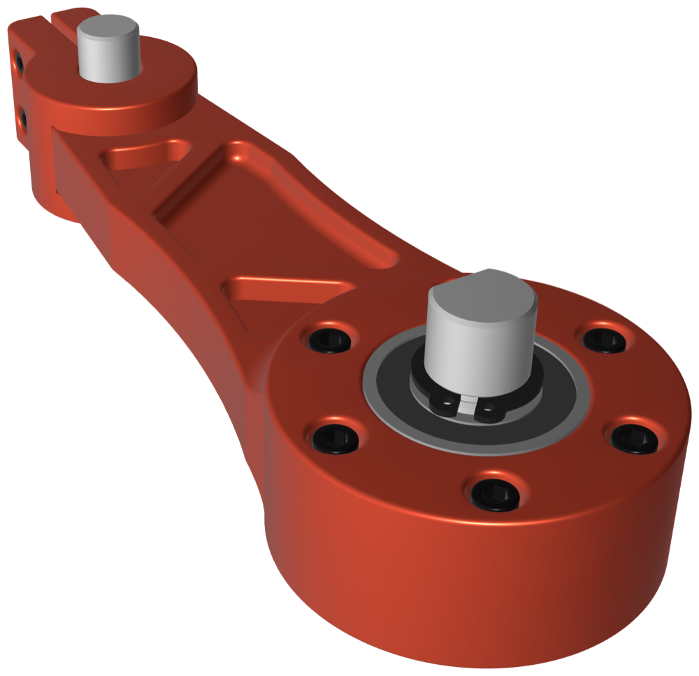
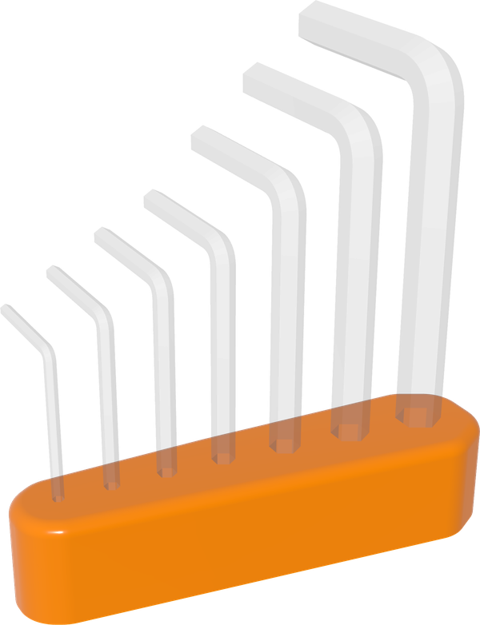

<h1>
  
  
</h1>


Cadova is a Swift library for creating 3D models through code, with a focus on 3D printing. It offers a programmable alternative to traditional CAD tools, combining precise geometry with the expressiveness and elegance of Swift.

Cadova models are written entirely in Swift, making them easy to version, reuse, and extend. The result is a flexible and maintainable approach to modeling, especially for those already comfortable with code.

Cadova runs on macOS, Windows, and Linux. To get started, read the [Getting Started guide](https://tomasf.github.io/Cadova/documentation/cadova/gettingstarted).

Full documentation, including [What is Cadova?](https://tomasf.github.io/Cadova/documentation/cadova/whatiscadova), is available at [cadova.org/docs](https://cadova.org/docs). See the [wiki](https://github.com/tomasf/Cadova/wiki) for related projects: the viewer app, libraries, and example models built with Cadova.

[](https://github.com/tomasf/Cadova/actions/workflows/main.yml)


## Example


```swift
await Model("Hex key holder") {
    // Hex holes for a set of keys, spaced by their own widths
    Stack(.x, spacing: 6, alignment: .centerY) {
        for size in [1.5, 2.0, 2.5, 3.0, 4.0, 5.0, 6.0] {
            RegularPolygon(sideCount: 6, widthAcrossFlats: size + 0.2)
        }
    }
    .offset(amount: 6, style: .round) { holes, outline in
        outline.convexHull()
            .extruded(height: 16, topEdge: .fillet(radius: 2))
            .subtracting {
                holes.extruded(height: 13)
                    .translated(z: 3)
            }
            .withMaterial(.glossyPlastic(.royalBlue))
    }
}
```
For more code examples, see [Examples](https://tomasf.github.io/Cadova/documentation/cadova/examples).

To preview your models, use [Cadova Viewer](https://github.com/tomasf/CadovaViewer), a native macOS app, or [Cadova for VS Code](https://github.com/tomasf/cadova-vscode), which works on every platform VS Code runs on. Both reload automatically as your model regenerates.

Cadova uses [Manifold-Swift](https://github.com/tomasf/manifold-swift), [Apus](https://github.com/tomasf/Apus), [Pelagos](https://github.com/tomasf/Pelagos), [Nodal](https://github.com/tomasf/Nodal) and [ThreeMF](https://github.com/tomasf/ThreeMF).


## Versioning and Stability

Cadova follows [semantic versioning](https://semver.org). From 1.0 on, the public API stays source compatible within a major version, so `from: "1.0.0"` is the recommended dependency requirement. Breaking changes only arrive in a new major version, and anything due to be removed is deprecated first.

## Contributions
Contributions are welcome! If you have ideas, suggestions, or improvements, feel free to open an issue or submit a pull request. You’re also welcome to browse the [open GitHub issues](https://github.com/tomasf/Cadova/issues) and pick one to work on — especially those marked as good first issues or help wanted.

## License
This project is licensed under the MIT license. See the LICENSE file for details.

## Manifest template
```swift
// swift-tools-version: 6.3
import PackageDescription

let package = Package(
    name: "<#name#>",
    platforms: [.macOS(.v15)],
    dependencies: [
        .package(url: "https://github.com/tomasf/Cadova.git", from: "1.0.0"),
    ],
    targets: [
        .executableTarget(
            name: "<#name#>",
            dependencies: ["Cadova"],
            swiftSettings: [.interoperabilityMode(.Cxx)]
        ),
    ]
)
```
